# Entity-relationship diagrams (tenant database)

Generated by `tools/erd/generate_erd.py` from `jaftim-local-db`: 224 tables, 341 relationships (87 declared FKs, 156 mined from procedure JOINs, 98 from column names).
Do not edit by hand - re-run the script after a schema change.

**Interactive version:** paste [`ERD.dbml`](ERD.dbml) into <https://dbdiagram.io/d> (same model, all domains,
draggable and searchable, tables grouped by domain).

- **Solid line** = declared foreign key. **Dotted line** = inferred, because the legacy schema declares few FKs:
  either the column is equated with that table's primary key in a procedure/view JOIN
  (`Base_DischargePort_Id = Stock_S_D_DischargeId`), or, failing that, its name matches (`Stock_SP_MakeId` ->
  `Base_Make`, `CustomerId` -> `UserProfile`). An inferred link is not a constraint - confirm it before relying on it.
- Audit columns (`CreatedBy`, `ModifiedBy`, ...) and `CompanyId` are on nearly every table and are not drawn.
- Each diagram shows its domain's tables in full; tables it references from other domains appear as key-only stubs.
  The lookup-table diagram shows keys only.
- Dead/scratch tables (`docs/DATABASE.md`) and the unused `AspNet*` tables are omitted.

## Contents

- [Stock: sales, reservation and money](#stock-sales-reservation-and-money) - 20 tables
- [Stock: logistics and documents](#stock-logistics-and-documents) - 18 tables
- [Stock: vehicle, status and lifecycle](#stock-vehicle-status-and-lifecycle) - 16 tables
- [Customers, wallets and finance](#customers-wallets-and-finance) - 25 tables
- [Users, roles and security](#users-roles-and-security) - 29 tables
- [Inquiries, leads and notifications](#inquiries-leads-and-notifications) - 12 tables
- [Shipping](#shipping) - 5 tables
- [Transport quoting](#transport-quoting) - 12 tables
- [Vendors](#vendors) - 5 tables
- [Reports](#reports) - 3 tables
- [respond.io integration](#respondio-integration) - 11 tables
- [Lookup tables](#lookup-tables) - 68 tables

## Stock: sales, reservation and money

```mermaid
erDiagram
    CustomerFavouriteStock {
        bigint Id PK
        bigint CustomerId FK
        bigint StockId FK
        bit IsActive
        int IsDeleted
        datetime CreatedAt
        bigint CreatedBy
        datetime ModifiedAt
        bigint ModifiedBy
        uniqueidentifier DeviceId
    }
    prc_stock_price_updates {
        bigint Id PK
        bigint StockId FK
        numeric InitialBossPrice
        numeric InitialDisplayPrice
        numeric NewBossPrice
        numeric NewDisplayPrice
        numeric BossPriceDiscountPct
        numeric DisplayPriceDiscountPct
        tinyint Status
        date ExpiryDate
        tinyint IsDeleted
        datetime CreatedAt
        bigint CreatedBy
        datetime ModifiedAt
        bigint ModifiedBy
        bigint CompanyId
    }
    Stock_Adjustment {
        bigint Id PK
        bigint FK_StockId FK
        bigint AdjustmentType FK
        int ApprovalStatus FK
        numeric AdjustmentAmount
        nvarchar Reason
        int IsDeleted
        bigint CreatedBy
        datetime CreatedAt
        bigint ModifiedBy
        datetime ModifiedAt
        bigint CompanyId
        nvarchar Remarks
        bigint FK_CustomerId FK
        nvarchar Reference
        nvarchar Currency
    }
    Stock_Allocation_History {
        bigint Stock_A_H_Id PK
        bigint Stock_Id FK
        bigint FK_BankStatementDetailApproval_Id FK
        bigint Stock_A_H_CustomerId FK
        int Stock_A_H_CurrencyId FK
        nvarchar Stock_A_H_CustomerName
        numeric Stock_A_H_AllocationAmount
        numeric Stock_A_H_RemainingAmount
        datetime Stock_A_H_Date
        bigint CreatedBy
        bigint ModifiedBy
        datetime CreatedAt
        datetime ModifiedAt
        bigint IsDeleted
        bigint CompanyId
        bit IsAdjustment
    }
    Stock_Cancellation {
        bigint Stock_Cancellation_Id PK
        bigint Stock_Id FK
        bigint CustomerId FK
        nvarchar Reason
        bigint CreatedBy
        bigint ModifiedBy
        datetime CreatedAt
        datetime ModifiedAt
        bigint IsDeleted
        bigint CompanyId
    }
    Stock_Cost_Detail {
        bigint Stock_C_D_Id PK
        bigint Stock_Id FK
        numeric Stock_C_D_TotalCost
        numeric Stock_C_D_BuyingPrice
        numeric Stock_C_D_VAT
        numeric Stock_C_D_Duty
        numeric Stock_C_D_AuctionFee
        numeric Stock_C_D_Repair
        numeric Stock_C_D_ShippingCharges
        numeric Stock_C_D_Rediation
        numeric Stock_C_D_StorageCharges
        numeric Stock_C_D_ExportPassing
        numeric Stock_C_D_ExportPaper
        numeric Stock_C_D_RTAPassing
        numeric Stock_C_D_OtherCharges
        bigint CreatedBy
        bigint ModifiedBy
        datetime CreatedAt
        datetime ModifiedAt
        bigint IsDeleted
        bigint CompanyId
        numeric Stock_C_D_Waiver
    }
    Stock_CustomerOrder {
        bigint Stock_CustomerOrderId PK
        bigint FK_Stock_Id FK
        bigint FK_CustomerId FK
        datetime CreatedAt
        datetime ModifiedAt
        bigint CreatedBy
        bigint ModifiedBy
        int IsDeleted
    }
    Stock_Deallocation_Request {
        bigint Id PK
        bigint StockId FK
        bigint CustomerId FK
        decimal Amount
        int ApprovalStatus
        nvarchar Remarks
        nvarchar FinanceRemarks
        bigint CreatedBy
        datetime CreatedAt
        bigint ModifiedBy
        datetime ModifiedAt
        bit IsDeleted
        bigint CompanyId
    }
    Stock_Discount_Requests {
        bigint Id PK
        bigint Stock_RB_D_Id FK
        bigint StockId FK
        bigint CustomerId FK
        numeric RequestedAmount
        tinyint DiscountRequestStatus
        bigint PendingOnUserId
        bigint PendingOnRoleId
        tinyint IsDeleted
        datetime CreatedAt
        bigint CreatedBy
        datetime ModifiedAt
        bigint ModifiedBy
        bigint CompanyId
    }
    Stock_Financial {
        bigint Stock_F_Id PK
        bigint Stock_Id FK
        numeric Stock_F_Amount
        nvarchar Stock_F_Remarks
        int Stock_F_FinancialTypeId FK
        bigint CreatedBy
        bigint ModifiedBy
        datetime CreatedAt
        datetime ModifiedAt
        bigint IsDeleted
        bigint CompanyId
        bigint Stock_R_D_Id FK
        bigint Stock_R_D_CustomerId FK
        bigint VendorJobId FK
    }
    Stock_Financial_History {
        bigint HistoryId PK
        bigint Stock_F_Id FK
        bigint Stock_Id FK
        numeric Stock_F_Amount
        nvarchar Stock_F_Remarks
        int Stock_F_FinancialTypeId FK
        bigint CreatedBy
        bigint ModifiedBy
        datetime CreatedAt
        datetime ModifiedAt
        bigint IsDeleted
        bigint CompanyId
        bigint Stock_R_D_Id FK
        bigint Stock_R_D_CustomerId FK
        varchar AuditAction
        datetime AuditAt
        bigint AuditBy FK
    }
    Stock_FinancialBid {
        bigint Stock_FB_Id PK
        bigint Stock_Id FK
        bigint Stock_RB_D_Id FK
        numeric Stock_F_Amount
        nvarchar Stock_F_Remarks
        int Stock_F_FinancialTypeId FK
        bigint CreatedBy
        bigint ModifiedBy
        datetime CreatedAt
        datetime ModifiedAt
        bigint IsDeleted
        bigint CompanyId
    }
    Stock_Modification_Price {
        bigint Stock_M_P_Id PK
        bigint Stock_Id FK
        bigint Stock_M_P_ModificationTypeId FK
        nvarchar Stock_M_P_ModificationType
        numeric Stock_M_P_Amount
        nvarchar Stock_M_P_Remarks
        bigint CreatedBy
        bigint ModifiedBy
        datetime CreatedAt
        datetime ModifiedAt
        bigint IsDeleted
        bigint CompanyId
        bigint Stock_R_D_CustomerId FK
    }
    Stock_Modification_Price_History {
        bigint HistoryId PK
        bigint Stock_M_P_Id FK
        bigint Stock_Id FK
        bigint Stock_M_P_ModificationTypeId FK
        nvarchar Stock_M_P_ModificationType
        numeric Stock_M_P_Amount
        nvarchar Stock_M_P_Remarks
        bigint CreatedBy
        bigint ModifiedBy
        datetime CreatedAt
        datetime ModifiedAt
        bigint IsDeleted
        bigint CompanyId
        bigint Stock_R_D_CustomerId FK
        varchar AuditAction
        datetime AuditAt
        bigint AuditBy FK
    }
    Stock_ModificationBid_Price {
        bigint Stock_MB_P_Id PK
        bigint Stock_Id FK
        bigint Stock_RB_D_Id FK
        bigint Stock_M_P_ModificationTypeId FK
        nvarchar Stock_M_P_ModificationType
        numeric Stock_M_P_Amount
        nvarchar Stock_M_P_Remarks
        bigint CreatedBy
        bigint ModifiedBy
        datetime CreatedAt
        datetime ModifiedAt
        bigint IsDeleted
        bigint CompanyId
    }
    Stock_Refund {
        bigint Stock_R_Id PK
        bigint Stock_Id FK
        numeric Stock_R_VAT
        numeric Stock_R_Duty
        numeric Stock_R_RecycleFee
        bigint CreatedBy
        bigint ModifiedBy
        datetime CreatedAt
        datetime ModifiedAt
        bigint IsDeleted
        bigint CompanyId
    }
    Stock_Reservation_Detail {
        bigint Stock_R_D_Id PK
        bigint Stock_Id FK
        bigint Stock_R_D_SalesPersonId FK
        bigint Stock_R_D_CustomerId FK
        bigint Stock_R_D_DepositeRatioId FK
        numeric Stock_R_D_FOBPrice
        bigint Stock_R_D_Destination_CountryId FK
        bigint Stock_R_D_PortOfDischargeId FK
        bigint Stock_R_D_ShippmentTypeId FK
        bigint Stock_R_D_ContainerTypeId FK
        numeric Stock_R_D_FreightAmount
        numeric Stock_R_D_VanningAmount
        numeric Stock_R_D_ExtrasAmount
        nvarchar Stock_R_D_SpecialInstruction
        bigint Stock_R_D_FreightTypeId FK
        bigint Stock_R_D_CurrencyId FK
        bigint CreatedBy
        bigint ModifiedBy
        datetime CreatedAt
        datetime ModifiedAt
        bigint IsDeleted
        bigint CompanyId
        bigint AssociateCustomerId FK
        numeric Stock_R_D_Discount
    }
    Stock_Reservation_Detail_History {
        bigint HistoryId PK
        bigint Stock_R_D_Id FK
        bigint Stock_Id FK
        bigint Stock_R_D_SalesPersonId FK
        bigint Stock_R_D_CustomerId FK
        bigint Stock_R_D_DepositeRatioId
        numeric Stock_R_D_FOBPrice
        bigint Stock_R_D_Destination_CountryId FK
        bigint Stock_R_D_PortOfDischargeId FK
        bigint Stock_R_D_ShippmentTypeId FK
        bigint Stock_R_D_ContainerTypeId FK
        numeric Stock_R_D_FreightAmount
        numeric Stock_R_D_VanningAmount
        numeric Stock_R_D_ExtrasAmount
        nvarchar Stock_R_D_SpecialInstruction
        bigint Stock_R_D_FreightTypeId FK
        bigint Stock_R_D_CurrencyId FK
        bigint CreatedBy
        bigint ModifiedBy
        datetime CreatedAt
        datetime ModifiedAt
        bigint IsDeleted
        bigint CompanyId
        bigint AssociateCustomerId FK
        varchar AuditAction
        datetime AuditAt
        bigint AuditBy FK
    }
    Stock_ReservationBid {
        bigint Stock_RB_Id PK
        bigint Stock_Id FK
        bigint Stock_RB_D_Id FK
        bit IsActive
        bigint CreatedBy
        bigint ModifiedBy
        datetime CreatedAt
        datetime ModifiedAt
        bigint IsDeleted
        bigint CompanyId
    }
    Stock_ReservationBid_Detail {
        bigint Stock_RB_D_Id PK
        bigint Stock_Id FK
        bigint Stock_RB_D_SalesPersonId FK
        bigint Stock_RB_D_CustomerId FK
        bigint Stock_RB_D_DepositeRatioId FK
        numeric Stock_RB_D_FOBPrice
        bigint Stock_RB_D_Destination_CountryId FK
        bigint Stock_RB_D_PortOfDischargeId FK
        bigint Stock_RB_D_ShippmentTypeId FK
        bigint Stock_RB_D_ContainerTypeId FK
        numeric Stock_RB_D_FreightAmount
        numeric Stock_RB_D_VanningAmount
        numeric Stock_RB_D_ExtrasAmount
        nvarchar Stock_RB_D_SpecialInstruction
        bigint Stock_RB_D_FreightTypeId FK
        bigint Stock_RB_D_CurrencyId FK
        numeric Stock_RB_D_InspectionAmount
        numeric Stock_RB_D_InsuranceAmount
        numeric Stock_RB_D_ModificationAmount
        numeric Stock_RB_D_OtherModificationAmount
        bigint CreatedBy
        bigint ModifiedBy
        datetime CreatedAt
        datetime ModifiedAt
        bigint IsDeleted
        bigint CompanyId
        bigint AssociateCustomerId FK
        numeric Stock_RB_D_Discount
    }
    BankStatementDetailApproval {
        bigint BankStatementDetailApproval_Id PK
        bigint FK_BankStatementDetail_Id FK
        bigint BankStatementDetailApproval_TransactionTypeId FK
        bigint BankStatementDetailApproval_CommentBy FK
    }
    Base_AdjustmentType {
        bigint Base_AdjustmentTypeId PK
    }
    Base_Approved {
        int ApprovedId PK
    }
    Base_ContainerType {
        bigint Base_ContainerType_Id PK
    }
    Base_Country {
        bigint Base_Country_Id PK
    }
    Base_Currency {
        bigint Base_Currency_Id PK
    }
    Base_DischargePort {
        bigint Base_DischargePort_Id PK
        bigint FK_Base_DischargeCountry_Id FK
    }
    Base_FinancialType {
        bigint Base_FinancialType_Id PK
    }
    Base_FreightType {
        bigint Base_FreightType_Id PK
    }
    Base_MinDepositeRequired {
        bigint Base_MinDepositeRequired_Id PK
    }
    Base_ModificationType {
        bigint Base_ModificationType_Id PK
    }
    Base_OriginCountry {
        bigint Base_OriginCountry_Id PK
    }
    Base_ShippmentType {
        bigint Base_ShippmentType_Id PK
    }
    Stock {
        bigint Stock_Id PK
        bigint Stock_StockTypeId FK
        bigint Stock_SupplierId FK
        bigint Stock_OriginCountryId FK
        bigint Stock_MinDepositeRequired_Id FK
        bigint Stock_CountryId FK
        bigint Stock_PurchasedCountryId FK
        bigint Stock_CityId FK
        bigint Stock_YardId FK
        bigint Stock_LocationId FK
        int Stock_C_J_Status FK
    }
    UserProfile {
        bigint UserProfileId PK
        bigint RoleId FK
        int GenderId FK
        int CountryId FK
        int CityId FK
        int StatusId FK
        bigint ReportsTo_UserId FK
        bigint RI_ContactId FK
    }
    VendorJob {
        bigint VendorJobId PK
        bigint VendorId FK
        bigint StockId FK
    }
    UserProfile ||..o{ CustomerFavouriteStock : "CustomerId"
    Stock ||..o{ CustomerFavouriteStock : "StockId"
    Base_AdjustmentType ||..o{ Stock_Adjustment : "AdjustmentType"
    Base_Approved ||..o{ Stock_Adjustment : "ApprovalStatus"
    UserProfile ||..o{ Stock_Adjustment : "FK_CustomerId"
    Stock ||..o{ Stock_Adjustment : "FK_StockId"
    BankStatementDetailApproval ||..o{ Stock_Allocation_History : "FK_BankStatementDetailApproval_Id"
    Base_Currency ||..o{ Stock_Allocation_History : "Stock_A_H_CurrencyId"
    UserProfile ||..o{ Stock_Allocation_History : "Stock_A_H_CustomerId"
    Stock ||..o{ Stock_Allocation_History : "Stock_Id"
    UserProfile ||..o{ Stock_Cancellation : "CustomerId"
    Stock ||..o{ Stock_Cancellation : "Stock_Id"
    Stock ||..o{ Stock_Cost_Detail : "Stock_Id"
    UserProfile ||..o{ Stock_CustomerOrder : "FK_CustomerId"
    Stock ||..o{ Stock_CustomerOrder : "FK_Stock_Id"
    UserProfile ||..o{ Stock_Deallocation_Request : "CustomerId"
    Stock ||..o{ Stock_Deallocation_Request : "StockId"
    UserProfile ||..o{ Stock_Discount_Requests : "CustomerId"
    Stock ||..o{ Stock_Discount_Requests : "StockId"
    Stock_ReservationBid_Detail ||..o{ Stock_Discount_Requests : "Stock_RB_D_Id"
    Base_FinancialType ||..o{ Stock_Financial : "Stock_F_FinancialTypeId"
    Stock ||..o{ Stock_Financial : "Stock_Id"
    UserProfile ||..o{ Stock_Financial : "Stock_R_D_CustomerId"
    Stock_Reservation_Detail ||..o{ Stock_Financial : "Stock_R_D_Id"
    VendorJob ||--o{ Stock_Financial : "VendorJobId"
    Base_FinancialType ||..o{ Stock_FinancialBid : "Stock_F_FinancialTypeId"
    Stock ||..o{ Stock_FinancialBid : "Stock_Id"
    Stock_ReservationBid_Detail ||..o{ Stock_FinancialBid : "Stock_RB_D_Id"
    UserProfile ||..o{ Stock_Financial_History : "AuditBy"
    Base_FinancialType ||..o{ Stock_Financial_History : "Stock_F_FinancialTypeId"
    Stock_Financial ||..o{ Stock_Financial_History : "Stock_F_Id"
    Stock ||..o{ Stock_Financial_History : "Stock_Id"
    UserProfile ||..o{ Stock_Financial_History : "Stock_R_D_CustomerId"
    Stock_Reservation_Detail ||..o{ Stock_Financial_History : "Stock_R_D_Id"
    Stock ||..o{ Stock_ModificationBid_Price : "Stock_Id"
    Base_ModificationType ||..o{ Stock_ModificationBid_Price : "Stock_M_P_ModificationTypeId"
    Stock_ReservationBid_Detail ||..o{ Stock_ModificationBid_Price : "Stock_RB_D_Id"
    Stock ||..o{ Stock_Modification_Price : "Stock_Id"
    Base_ModificationType ||..o{ Stock_Modification_Price : "Stock_M_P_ModificationTypeId"
    UserProfile ||..o{ Stock_Modification_Price : "Stock_R_D_CustomerId"
    UserProfile ||..o{ Stock_Modification_Price_History : "AuditBy"
    Stock ||..o{ Stock_Modification_Price_History : "Stock_Id"
    Stock_Modification_Price ||..o{ Stock_Modification_Price_History : "Stock_M_P_Id"
    Base_ModificationType ||..o{ Stock_Modification_Price_History : "Stock_M_P_ModificationTypeId"
    UserProfile ||..o{ Stock_Modification_Price_History : "Stock_R_D_CustomerId"
    Stock ||..o{ Stock_Refund : "Stock_Id"
    Stock ||..o{ Stock_ReservationBid : "Stock_Id"
    Stock_ReservationBid_Detail ||..o{ Stock_ReservationBid : "Stock_RB_D_Id"
    UserProfile ||..o{ Stock_ReservationBid_Detail : "AssociateCustomerId"
    Stock ||..o{ Stock_ReservationBid_Detail : "Stock_Id"
    Base_ContainerType ||..o{ Stock_ReservationBid_Detail : "Stock_RB_D_ContainerTypeId"
    Base_Currency ||..o{ Stock_ReservationBid_Detail : "Stock_RB_D_CurrencyId"
    UserProfile ||..o{ Stock_ReservationBid_Detail : "Stock_RB_D_CustomerId"
    Base_MinDepositeRequired ||..o{ Stock_ReservationBid_Detail : "Stock_RB_D_DepositeRatioId"
    Base_Country ||..o{ Stock_ReservationBid_Detail : "Stock_RB_D_Destination_CountryId"
    Base_FreightType ||..o{ Stock_ReservationBid_Detail : "Stock_RB_D_FreightTypeId"
    Base_DischargePort ||..o{ Stock_ReservationBid_Detail : "Stock_RB_D_PortOfDischargeId"
    UserProfile ||..o{ Stock_ReservationBid_Detail : "Stock_RB_D_SalesPersonId"
    Base_ShippmentType ||..o{ Stock_ReservationBid_Detail : "Stock_RB_D_ShippmentTypeId"
    UserProfile ||..o{ Stock_Reservation_Detail : "AssociateCustomerId"
    Stock ||..o{ Stock_Reservation_Detail : "Stock_Id"
    Base_ContainerType ||..o{ Stock_Reservation_Detail : "Stock_R_D_ContainerTypeId"
    Base_Currency ||..o{ Stock_Reservation_Detail : "Stock_R_D_CurrencyId"
    UserProfile ||..o{ Stock_Reservation_Detail : "Stock_R_D_CustomerId"
    Base_MinDepositeRequired ||..o{ Stock_Reservation_Detail : "Stock_R_D_DepositeRatioId"
    Base_OriginCountry ||..o{ Stock_Reservation_Detail : "Stock_R_D_Destination_CountryId"
    Base_FreightType ||..o{ Stock_Reservation_Detail : "Stock_R_D_FreightTypeId"
    Base_DischargePort ||..o{ Stock_Reservation_Detail : "Stock_R_D_PortOfDischargeId"
    UserProfile ||..o{ Stock_Reservation_Detail : "Stock_R_D_SalesPersonId"
    Base_ShippmentType ||..o{ Stock_Reservation_Detail : "Stock_R_D_ShippmentTypeId"
    UserProfile ||..o{ Stock_Reservation_Detail_History : "AssociateCustomerId"
    UserProfile ||..o{ Stock_Reservation_Detail_History : "AuditBy"
    Stock ||..o{ Stock_Reservation_Detail_History : "Stock_Id"
    Base_ContainerType ||..o{ Stock_Reservation_Detail_History : "Stock_R_D_ContainerTypeId"
    Base_Currency ||..o{ Stock_Reservation_Detail_History : "Stock_R_D_CurrencyId"
    UserProfile ||..o{ Stock_Reservation_Detail_History : "Stock_R_D_CustomerId"
    Base_Country ||..o{ Stock_Reservation_Detail_History : "Stock_R_D_Destination_CountryId"
    Base_FreightType ||..o{ Stock_Reservation_Detail_History : "Stock_R_D_FreightTypeId"
    Stock_Reservation_Detail ||..o{ Stock_Reservation_Detail_History : "Stock_R_D_Id"
    Base_DischargePort ||..o{ Stock_Reservation_Detail_History : "Stock_R_D_PortOfDischargeId"
    UserProfile ||..o{ Stock_Reservation_Detail_History : "Stock_R_D_SalesPersonId"
    Base_ShippmentType ||..o{ Stock_Reservation_Detail_History : "Stock_R_D_ShippmentTypeId"
    Stock ||--o{ prc_stock_price_updates : "StockId"
```

## Stock: logistics and documents

```mermaid
erDiagram
    Stock_BL_Detail {
        bigint Stock_BL_D_Id PK
        bigint Stock_Id FK
        nvarchar Stock_BL_D_No
        datetime Stock_BL_D_Date
        datetime Stock_BL_D_ETA
        datetime Stock_BL_D_ETD
        bigint CreatedBy
        bigint ModifiedBy
        datetime CreatedAt
        datetime ModifiedAt
        bigint IsDeleted
        bigint CompanyId
    }
    Stock_BL_Detail_History {
        bigint HistoryId PK
        bigint Stock_BL_D_Id FK
        bigint Stock_Id FK
        nvarchar Stock_BL_D_No
        datetime Stock_BL_D_Date
        datetime Stock_BL_D_ETA
        datetime Stock_BL_D_ETD
        bigint CreatedBy
        bigint ModifiedBy
        datetime CreatedAt
        datetime ModifiedAt
        bigint IsDeleted
        bigint CompanyId
        varchar AuditAction
        datetime AuditAt
        bigint AuditBy FK
    }
    Stock_Courier_Info {
        bigint Stock_C_I_Id PK
        bigint Stock_Id FK
        nvarchar Stock_C_I_Name
        nvarchar Stock_C_I_Tracking_Number
        nvarchar Stock_C_I_Customer_Name
        nvarchar Stock_C_I_Customer_Phone
        nvarchar Stock_C_I_Customer_Address
        bigint CreatedBy
        bigint ModifiedBy
        datetime CreatedAt
        datetime ModifiedAt
        bigint IsDeleted
        bigint CompanyId
    }
    Stock_File {
        bigint Stock_File_Id PK
        bigint Stock_FK_Folder_Id FK
        bigint Stock_Id FK
        nvarchar Stock_File_Name
        nvarchar Stock_File_URL
        nvarchar Stock_File_Extension
        bigint Stock_File_Size
        nvarchar Stock_File_Icon
        bigint CreatedBy
        bigint ModifiedBy
        datetime CreatedAt
        datetime ModifiedAt
        bigint IsDeleted
        bigint CompanyId
        bit IsSyncedWithOldErp
    }
    Stock_Folder {
        bigint Stock_Folder_Id PK
        bigint Stock_Id FK
        nvarchar Stock_Folder_Name
        bigint Stock_Folder_Parent_Id
        int Stock_System_Id
        int Stock_Folder_Type_Id
        bigint CreatedBy
        bigint ModifiedBy
        datetime CreatedAt
        datetime ModifiedAt
        bigint IsDeleted
        bigint CompanyId
    }
    Stock_Image {
        bigint StockImageId PK
        bigint StockId FK
        nvarchar ImageUrl
        nvarchar ImageThumbnailUrl
        bigint CreatedBy
        bigint ModifiedBy
        datetime CreatedAt
        datetime ModifiedAt
        bigint IsDeleted
        bigint CompanyId
    }
    Stock_Inspection {
        bigint Stock_I_Id PK
        bigint Stock_Id FK
        bit Stock_I_Booked
        date Stock_I_Date
        bit Stock_I_Result
        nvarchar Stock_I_Reason
        bit Stock_I_CertificateStatus
        date Stock_I_CertificateDate
        bigint CreatedBy
        bigint ModifiedBy
        datetime CreatedAt
        datetime ModifiedAt
        bigint IsDeleted
        bigint CompanyId
        bigint Stock_R_D_CustomerId FK
        date Stock_I_ValidTill
    }
    Stock_Inspection_History {
        bigint HistoryId PK
        bigint Stock_I_Id FK
        bigint Stock_Id FK
        bit Stock_I_Booked
        date Stock_I_Date
        bit Stock_I_Result
        nvarchar Stock_I_Reason
        bit Stock_I_CertificateStatus
        date Stock_I_CertificateDate
        bigint CreatedBy
        bigint ModifiedBy
        datetime CreatedAt
        datetime ModifiedAt
        bigint IsDeleted
        bigint CompanyId
        varchar AuditAction
        datetime AuditAt
        bigint AuditBy FK
        bigint Stock_R_D_CustomerId FK
        date Stock_I_ValidTill
    }
    Stock_InternalNote {
        bigint Stock_I_N_Id PK
        bigint Stock_Id FK
        nvarchar InternalNote
        bigint CreatedBy
        bigint ModifiedBy
        datetime CreatedAt
        datetime ModifiedAt
        bigint IsDeleted
        bigint CompanyId
    }
    Stock_Port_Detail {
        bigint Stock_P_D_Id PK
        bigint Stock_Id FK
        bigint Stock_P_D_Ship_To FK
        datetime Stock_P_D_Date
        bigint CreatedBy
        bigint ModifiedBy
        datetime CreatedAt
        datetime ModifiedAt
        bigint IsDeleted
        bigint CompanyId
    }
    Stock_Port_Detail_History {
        bigint HistoryId PK
        bigint Stock_P_D_Id FK
        bigint Stock_Id FK
        bigint Stock_P_D_Ship_To FK
        datetime Stock_P_D_Date
        bigint CreatedBy
        bigint ModifiedBy
        datetime CreatedAt
        datetime ModifiedAt
        bigint IsDeleted
        bigint CompanyId
        varchar AuditAction
        datetime AuditAt
        bigint AuditBy FK
    }
    Stock_Shipment_Detail {
        bigint Stock_S_D_Id PK
        bigint Stock_Id FK
        bigint Stock_S_D_Shipping_CompanyId FK
        nvarchar Stock_S_D_Vessel_Name
        nvarchar Stock_S_D_Voyage_No
        bigint Stock_S_D_DischargeId FK
        bigint Stock_S_D_Freight_StatusId FK
        bigint Stock_S_D_Container_TypeId FK
        nvarchar Stock_S_D_Inner_Cargo
        bigint CreatedBy
        bigint ModifiedBy
        datetime CreatedAt
        datetime ModifiedAt
        bigint IsDeleted
        bigint CompanyId
        nvarchar Stock_S_D_Job_No
    }
    Stock_ShipmentParty {
        bigint Stock_ShipmentParty_Id PK
        bigint Stock_Id FK
        int ShipmentParty_Id FK
        bigint CreatedBy
        bigint ModifiedBy
        datetime CreatedAt
        datetime ModifiedAt
        bigint IsDeleted
        bigint CompanyId
    }
    Stock_Videos {
        bigint Stock_Video_Id PK
        bigint Stock_Id FK
        nvarchar Stock_Video_Url
        datetime CreatedAt
        datetime ModifiedAt
        nvarchar CreatedBy
        nvarchar ModifiedBy
        bit IsDeleted
        bigint CompanyId
    }
    StockImages {
        bigint stock_image_id PK
        bigint stock_id FK
        nvarchar image_name
        nvarchar stock_image
        nvarchar stock_image_path
        bit flag
        bit status
        bigint created_by
        datetime created_at
        bigint updated_by
        datetime updated_at
        bigint deleted_by
        datetime deleted_at
        nvarchar stock_image_azure
    }
    StockStatusRefreshOutbox {
        bigint OutboxId PK
        bigint StockId FK
        nvarchar EventType
        datetime2 CreatedAtUtc
        datetime2 PublishedAtUtc
        uniqueidentifier LeaseId
        datetime2 LeasedUntilUtc
        int AttemptCount
        nvarchar LastError
    }
    StockWorkflowTask {
        bigint TaskId PK
        bigint NotificationId FK
        bigint StockId FK
        varchar RequestType
        varchar Status
        bigint CompletedBy
        datetime CompletedAt
        bigint IsDeleted
        bigint CreatedBy
        datetime CreatedAt
        bigint CompanyId
    }
    web_stock_tabs {
        bigint Id PK
        varchar Name
        varchar FilterKey
        datetime CreatedAt
        bigint CreatedBy
        datetime ModifiedAt
        bigint ModifiedBy
        varchar FilterValue
        bit IsActive
    }
    Base_ContainerType {
        bigint Base_ContainerType_Id PK
    }
    Base_DischargePort {
        bigint Base_DischargePort_Id PK
        bigint FK_Base_DischargeCountry_Id FK
    }
    Base_FreightStatus {
        bigint Base_FreightStatus_Id PK
    }
    Base_ShippingCompany {
        bigint Base_ShippingCompany_Id PK
        bigint FK_Base_Country_Id FK
    }
    Notification {
        bigint NotificationId PK
        int NotificationTypeId FK
        bigint EntityId FK
    }
    ShipmentParty {
        bigint ShipmentParty_Id PK
        bigint CustomerId FK
    }
    Stock {
        bigint Stock_Id PK
        bigint Stock_StockTypeId FK
        bigint Stock_SupplierId FK
        bigint Stock_OriginCountryId FK
        bigint Stock_MinDepositeRequired_Id FK
        bigint Stock_CountryId FK
        bigint Stock_PurchasedCountryId FK
        bigint Stock_CityId FK
        bigint Stock_YardId FK
        bigint Stock_LocationId FK
        int Stock_C_J_Status FK
    }
    UserProfile {
        bigint UserProfileId PK
        bigint RoleId FK
        int GenderId FK
        int CountryId FK
        int CityId FK
        int StatusId FK
        bigint ReportsTo_UserId FK
        bigint RI_ContactId FK
    }
    Stock ||..o{ StockImages : "stock_id"
    Stock ||..o{ StockStatusRefreshOutbox : "StockId"
    Notification ||--o{ StockWorkflowTask : "NotificationId"
    Stock ||..o{ StockWorkflowTask : "StockId"
    Stock ||..o{ Stock_BL_Detail : "Stock_Id"
    UserProfile ||..o{ Stock_BL_Detail_History : "AuditBy"
    Stock_BL_Detail ||..o{ Stock_BL_Detail_History : "Stock_BL_D_Id"
    Stock ||..o{ Stock_BL_Detail_History : "Stock_Id"
    Stock ||..o{ Stock_Courier_Info : "Stock_Id"
    Stock_Folder ||..o{ Stock_File : "Stock_FK_Folder_Id"
    Stock ||..o{ Stock_File : "Stock_Id"
    Stock ||..o{ Stock_Folder : "Stock_Id"
    Stock ||..o{ Stock_Image : "StockId"
    Stock ||..o{ Stock_Inspection : "Stock_Id"
    UserProfile ||..o{ Stock_Inspection : "Stock_R_D_CustomerId"
    UserProfile ||..o{ Stock_Inspection_History : "AuditBy"
    Stock_Inspection ||..o{ Stock_Inspection_History : "Stock_I_Id"
    Stock ||..o{ Stock_Inspection_History : "Stock_Id"
    UserProfile ||..o{ Stock_Inspection_History : "Stock_R_D_CustomerId"
    Stock ||..o{ Stock_InternalNote : "Stock_Id"
    Stock ||..o{ Stock_Port_Detail : "Stock_Id"
    Base_DischargePort ||..o{ Stock_Port_Detail : "Stock_P_D_Ship_To"
    UserProfile ||..o{ Stock_Port_Detail_History : "AuditBy"
    Stock ||..o{ Stock_Port_Detail_History : "Stock_Id"
    Stock_Port_Detail ||..o{ Stock_Port_Detail_History : "Stock_P_D_Id"
    Base_DischargePort ||..o{ Stock_Port_Detail_History : "Stock_P_D_Ship_To"
    ShipmentParty ||..o{ Stock_ShipmentParty : "ShipmentParty_Id"
    Stock ||..o{ Stock_ShipmentParty : "Stock_Id"
    Stock ||..o{ Stock_Shipment_Detail : "Stock_Id"
    Base_ContainerType ||..o{ Stock_Shipment_Detail : "Stock_S_D_Container_TypeId"
    Base_DischargePort ||..o{ Stock_Shipment_Detail : "Stock_S_D_DischargeId"
    Base_FreightStatus ||..o{ Stock_Shipment_Detail : "Stock_S_D_Freight_StatusId"
    Base_ShippingCompany ||..o{ Stock_Shipment_Detail : "Stock_S_D_Shipping_CompanyId"
    Stock ||..o{ Stock_Videos : "Stock_Id"
```

## Stock: vehicle, status and lifecycle

```mermaid
erDiagram
    garagevisitype {
        bigint Id PK
        varchar Name
    }
    Stock {
        bigint Stock_Id PK
        bigint Stock_StockTypeId FK
        bigint Stock_SupplierId FK
        nvarchar Stock_Description
        bigint Stock_OriginCountryId FK
        bigint Stock_MinDepositeRequired_Id FK
        nvarchar Stock_Remarks
        bigint Stock_CountryId FK
        bigint Stock_PurchasedCountryId FK
        bigint Stock_CityId FK
        bigint Stock_YardId FK
        bigint Stock_LocationId FK
        date Stock_PurchaseDate
        nvarchar Stock_Procurer
        bigint CreatedBy
        bigint ModifiedBy
        datetime CreatedAt
        datetime ModifiedAt
        bigint IsDeleted
        bigint CompanyId
        nvarchar PromotionalNotes
        bigint Ref_Id
        datetime Stock_EstimatedArrivalDate
        datetime Stock_EstimatedDepartureDate
        int Stock_C_J_Status FK
        bit UpgradeRequired
        bigint StockCode
    }
    Stock_Feature {
        bigint Stock_F_S_Id PK
        bigint Stock_Id FK
        bigint Stock_F_S_Feature_Id FK
        bigint CreatedBy
        bigint ModifiedBy
        datetime CreatedAt
        datetime ModifiedAt
        bigint IsDeleted
        bigint CompanyId
    }
    Stock_Info {
        bigint Id PK
        bigint StockId FK
        int InfoTypeId FK
        bigint CreatedBy
        bigint ModifiedBy
        datetime CreatedAt
        datetime ModifiedAt
        bit IsDeleted
        bigint CompanyId
        bit IsActive
    }
    Stock_InfoTypes {
        int InfoTypeId PK
        varchar Name
        varchar Description
        bigint CreatedBy
        bigint ModifiedBy
        datetime CreatedAt
        datetime ModifiedAt
        bit IsDeleted
        bigint CompanyId
    }
    Stock_J_Status {
        int Id PK
        nvarchar Name
    }
    Stock_Price {
        bigint Stock_P_Id PK
        bigint Stock_Id FK
        numeric Stock_P_BossPrice
        numeric Stock_P_DisplayPrice
        numeric Stock_P_FOBPrice
        numeric Stock_P_CNFPrice
        bigint CreatedBy
        bigint ModifiedBy
        datetime CreatedAt
        datetime ModifiedAt
        bigint IsDeleted
        bigint CompanyId
    }
    Stock_Repair_Cost {
        bigint Stock_R_C_Id PK
        bigint Stock_Id FK
        bigint Stock_R_C_RepairTypeId FK
        nvarchar Stock_R_C_RepairType
        numeric Stock_R_C_Amount
        nvarchar Stock_R_C_Remarks
        bigint CreatedBy
        bigint ModifiedBy
        datetime CreatedAt
        datetime ModifiedAt
        bigint IsDeleted
        bigint CompanyId
    }
    Stock_Specification {
        bigint Stock_SP_Id PK
        bigint Stock_Id FK
        bigint Stock_SP_MakeId FK
        bigint Stock_SP_ModelId FK
        nvarchar Stock_SP_Derivative
        datetime Stock_SP_ManufactureDate
        datetime Stock_SP_RegistrationDate
        datetime Stock_SP_YardDate
        nvarchar Stock_SP_ChassisNo
        bigint Stock_SP_BodyTypeId FK
        bigint Stock_SP_ColorId FK
        int Stock_SP_EngineSize
        bigint Stock_SP_TransmissionId FK
        bigint Stock_SP_FuelTypeId FK
        int Stock_SP_Doors
        bigint Stock_SP_DriveTypeId FK
        int Stock_SP_Seats
        decimal Stock_SP_Mileage
        bigint Stock_SP_SteeringId FK
        nvarchar Stock_Unique_Selling_Proposition
        bigint CreatedBy
        bigint ModifiedBy
        datetime CreatedAt
        datetime ModifiedAt
        bigint IsDeleted
        bigint CompanyId
        int Stock_SP_RegisterMonth
        int Stock_SP_RegisterYear
        nvarchar Stock_SP_ModelCode
        int Stock_SP_ManufactureMonth
        int Stock_SP_ManufactureYear
        decimal Stock_SP_WorkingHours
        decimal Stock_SP_BucketCapacity
        bigint Stock_SP_SubBodyTypeId FK
    }
    Stock_Status {
        bigint Stock_S_Id PK
        bigint Stock_Id FK
        bigint Stock_S_AvailabilityStatusId FK
        bigint Stock_S_ReservationStatusId FK
        bit Stock_S_DepositeOK
        bit Stock_S_Paid
        bit Stock_S_ShipOK
        bit Stock_S_ReleaseOK
        bit Stock_S_Release
        bit Stock_S_PortLeave
        bigint CreatedBy
        bigint ModifiedBy
        datetime CreatedAt
        datetime ModifiedAt
        bigint IsDeleted
        bigint CompanyId
    }
    Stock_StatusDetail {
        bigint Stock_SD_Id PK
        bigint Stock_Id FK
        bigint Stock_SD_StockStatus_Id FK
        bigint Stock_SD_StockStatus_Value FK
        nvarchar Stock_SD_StockStatus_Reason
        bigint CreatedBy
        bigint ModifiedBy
        datetime CreatedAt
        datetime ModifiedAt
        bigint IsDeleted
        bigint CompanyId
    }
    Stock_Weight_Dimension {
        bigint Stock_W_D_Id PK
        bigint Stock_Id FK
        numeric Stock_W_D_Weight
        numeric Stock_W_D_Length
        numeric Stock_W_D_Width
        numeric Stock_W_D_Height
        bigint CreatedBy
        bigint ModifiedBy
        datetime CreatedAt
        datetime ModifiedAt
        bigint IsDeleted
        bigint CompanyId
        numeric Stock_W_D_TotalWeight
        numeric Stock_W_D_MaxLoadingCapacity
    }
    StockGarageVisit {
        bigint Id PK
        bigint StockId FK
        bigint GarageId
        datetime InDate
        datetime OutDate
        bigint VisitType
    }
    StockJourney {
        int Id PK
        bigint StockId FK
        int Status
        datetime ModifiedAt
        nvarchar ModifiedBy
        nvarchar Notes
    }
    StockType {
        int StockTypeId PK
        nvarchar StockTypeName
    }
    Supplier {
        bigint Supplier_Id PK
        nvarchar Supplier_Name
        bit Supplier_IsActive
        bigint CreatedBy
        bigint ModifiedBy
        datetime CreatedAt
        datetime ModifiedAt
        bigint IsDeleted
        bigint CompanyId
    }
    Base_Availability {
        bigint Base_Availability_Id PK
    }
    Base_BodyType {
        bigint Base_BodyType_Id PK
    }
    Base_City {
        bigint Base_City_Id PK
        bigint FK_Base_Country_Id FK
    }
    Base_Color {
        bigint Base_Color_Id PK
    }
    Base_Country {
        bigint Base_Country_Id PK
    }
    Base_DriveType {
        bigint Base_DriveType_Id PK
    }
    Base_FuelType {
        bigint Base_FuelType_Id PK
    }
    Base_Location {
        bigint Base_Location_Id PK
    }
    Base_Make {
        bigint Base_Make_Id PK
        bigint FK_Base_Country_ID FK
    }
    Base_MinDepositeRequired {
        bigint Base_MinDepositeRequired_Id PK
    }
    Base_Model {
        bigint Base_Model_Id PK
        bigint FK_Base_Make_Id FK
    }
    Base_OriginCountry {
        bigint Base_OriginCountry_Id PK
    }
    Base_RepairType {
        bigint Base_RepairType_Id PK
    }
    Base_ReservationStatus {
        bigint Base_ReservationStatus_Id PK
    }
    Base_Steering {
        bigint Base_Steering_Id PK
    }
    Base_Stock_Feature {
        bigint Base_Stock_Feature_Id PK
    }
    Base_StockStatus {
        bigint Base_StockStatus_Id PK
    }
    Base_StockType {
        bigint Base_StockType_Id PK
    }
    Base_SubBodyType {
        bigint Base_SubBodyType_Id PK
        bigint FK_Base_BodyType_Id FK
    }
    Base_Transmission {
        bigint Base_Transmission_Id PK
    }
    Base_Yard {
        bigint Base_Yard_Id PK
        bigint FK_Base_City_Id FK
    }
    UserProfile {
        bigint UserProfileId PK
        bigint RoleId FK
        int GenderId FK
        int CountryId FK
        int CityId FK
        int StatusId FK
        bigint ReportsTo_UserId FK
        bigint RI_ContactId FK
    }
    Stock_J_Status ||..o{ Stock : "Stock_C_J_Status"
    Base_City ||..o{ Stock : "Stock_CityId"
    Base_Country ||..o{ Stock : "Stock_CountryId"
    Base_Location ||..o{ Stock : "Stock_LocationId"
    Base_MinDepositeRequired ||..o{ Stock : "Stock_MinDepositeRequired_Id"
    Base_OriginCountry ||..o{ Stock : "Stock_OriginCountryId"
    Base_Country ||..o{ Stock : "Stock_PurchasedCountryId"
    Base_StockType ||..o{ Stock : "Stock_StockTypeId"
    UserProfile ||..o{ Stock : "Stock_SupplierId"
    Base_Yard ||..o{ Stock : "Stock_YardId"
    Stock ||..o{ StockGarageVisit : "StockId"
    Stock ||--o{ StockJourney : "StockId"
    Base_Stock_Feature ||..o{ Stock_Feature : "Stock_F_S_Feature_Id"
    Stock ||..o{ Stock_Feature : "Stock_Id"
    Stock_InfoTypes ||--o{ Stock_Info : "InfoTypeId"
    Stock ||--o{ Stock_Info : "StockId"
    Stock ||..o{ Stock_Price : "Stock_Id"
    Stock ||..o{ Stock_Repair_Cost : "Stock_Id"
    Base_RepairType ||..o{ Stock_Repair_Cost : "Stock_R_C_RepairTypeId"
    Stock ||..o{ Stock_Specification : "Stock_Id"
    Base_BodyType ||..o{ Stock_Specification : "Stock_SP_BodyTypeId"
    Base_Color ||..o{ Stock_Specification : "Stock_SP_ColorId"
    Base_DriveType ||..o{ Stock_Specification : "Stock_SP_DriveTypeId"
    Base_FuelType ||..o{ Stock_Specification : "Stock_SP_FuelTypeId"
    Base_Make ||..o{ Stock_Specification : "Stock_SP_MakeId"
    Base_Model ||..o{ Stock_Specification : "Stock_SP_ModelId"
    Base_Steering ||..o{ Stock_Specification : "Stock_SP_SteeringId"
    Base_SubBodyType ||..o{ Stock_Specification : "Stock_SP_SubBodyTypeId"
    Base_Transmission ||..o{ Stock_Specification : "Stock_SP_TransmissionId"
    Stock ||..o{ Stock_Status : "Stock_Id"
    Base_Availability ||..o{ Stock_Status : "Stock_S_AvailabilityStatusId"
    Base_ReservationStatus ||..o{ Stock_Status : "Stock_S_ReservationStatusId"
    Stock ||..o{ Stock_StatusDetail : "Stock_Id"
    Base_StockStatus ||..o{ Stock_StatusDetail : "Stock_SD_StockStatus_Id"
    Base_Availability ||..o{ Stock_StatusDetail : "Stock_SD_StockStatus_Value"
    Stock ||..o{ Stock_Weight_Dimension : "Stock_Id"
```

## Customers, wallets and finance

```mermaid
erDiagram
    BankStatement {
        bigint BankStatement_Id PK
        bigint BankStatement_BankId FK
        nvarchar BankStatement_FileURL
        bigint CreatedBy
        bigint ModifiedBy
        datetime CreatedAt
        datetime ModifiedAt
        bigint IsDeleted
        bigint CompanyId
    }
    BankStatementDetail {
        bigint BankStatementDetail_Id PK
        bigint FK_BankStatement_Id FK
        bigint FK_BankStatement_BankId FK
        datetime BankStatementDetail_Transaction_Date
        nvarchar BankStatementDetail_Transaction_ID
        nvarchar BankStatementDetail_Ref_No
        nvarchar BankStatementDetail_Bank_Name
        nvarchar BankStatementDetail_Remitter_Name
        nvarchar BankStatementDetail_Remitter_Bank
        nvarchar BankStatementDetail_Country_Address
        nvarchar BankStatementDetail_Currency
        numeric BankStatementDetail_Amount_Credit
        numeric BankStatementDetail_Bank_Charges
        bigint BankStatementDetail_Currency_Id FK
        bigint CreatedBy
        bigint ModifiedBy
        datetime CreatedAt
        datetime ModifiedAt
        bigint IsDeleted
        bigint CompanyId
        nvarchar Message
    }
    BankStatementDetailApproval {
        bigint BankStatementDetailApproval_Id PK
        bigint FK_BankStatementDetail_Id FK
        int BankStatementDetailApproval_ApprovalStatus
        bigint BankStatementDetailApproval_TransactionTypeId FK
        bigint BankStatementDetailApproval_StatusId
        bigint BankStatementDetailApproval_BusinessPartnerId
        nvarchar BankStatementDetailApproval_Document_TT_Copy_FileURL
        numeric BankStatementDetailApproval_AllocationAmount
        nvarchar BankStatementDetailApproval_Comment
        bigint BankStatementDetailApproval_CommentBy FK
        bigint BankStatementDetailApproval_ForUserTypeId
        bigint CreatedBy
        bigint ModifiedBy
        datetime CreatedAt
        datetime ModifiedAt
        bigint IsDeleted
        bigint CompanyId
    }
    BankStatementDetailApprovalComment {
        bigint BankStatementDetailApprovalComment_Id
        bigint FK_BankStatementDetailApproval_Id FK
        int BankStatementDetailApprovalComment_ApprovalStatus
        nvarchar BankStatementDetailApprovalComment_Comment
        bigint BankStatementDetailApprovalComment_CommentBy
        bigint CreatedBy
        bigint ModifiedBy
        datetime CreatedAt
        datetime ModifiedAt
        bigint IsDeleted
        bigint CompanyId
    }
    CompanyIncome {
        bigint Id PK
        int IncomeTypeId FK
        decimal Amount
        bigint CurrencyId FK
        bigint CustomerId FK
        nvarchar SourceType
        bigint SourceId FK
        nvarchar Remarks
        bigint CreatedBy
        datetime CreatedAt
        bit IsDeleted
        bigint CompanyId
    }
    CurrencyExchangeRates {
        int CurrencyPairID PK
        varchar BaseCurrency
        varchar QuoteCurrency
        decimal ExchangeRate
        datetime ValidFrom
        datetime ValidTo
        int BaseCurrencyId FK
        int QuoteCurrencyId
    }
    Customer_Wallet {
        bigint Customer_Wallet_Id PK
        bigint FK_CustomerId FK
        int Customer_CurrencyId FK
        numeric Customer_Wallet_Amount
        bigint CreatedBy
        bigint ModifiedBy
        datetime CreatedAt
        datetime ModifiedAt
        bigint IsDeleted
        bigint CompanyId
    }
    Customer_WalletDetail {
        bigint Customer_WalletDetail_Id PK
        bigint Customer_ConvertFromWallet_Id FK
        bigint Customer_ConvertToWallet_Id FK
        numeric Customer_WalletDetail_Amount
        numeric Customer_WalletDetail_Rate
        numeric Customer_WalletDetail_RequestedAmountOnRate
        int Customer_ApprovedId FK
        nvarchar Customer_RequestedComment
        nvarchar Customer_ResponseComment
        int Customer_TransactionModeId FK
        int Customer_ParentWalletDetail_Id
        int Customer_BankStatementDetail_Id FK
        bigint CreatedBy
        bigint ModifiedBy
        datetime CreatedAt
        datetime ModifiedAt
        bigint IsDeleted
        bigint CompanyId
    }
    Customer_WalletTransfer {
        bigint Customer_WalletTransfer_Id PK
        bigint SourceCustomerId FK
        bigint SourceWalletId FK
        bigint TargetCustomerId FK
        bigint TargetWalletId FK
        int CurrencyId FK
        numeric Amount
        int ApprovalStatus
        nvarchar Reason
        nvarchar FinanceRemarks
        bigint SourceWalletDetailId
        bigint TargetWalletDetailId
        bigint CreatedBy
        datetime CreatedAt
        bigint ModifiedBy
        datetime ModifiedAt
        bit IsDeleted
        bigint CompanyId
    }
    Customer_WalletTransferApproverRole {
        bigint Customer_WalletTransferApproverRole_Id PK
        bigint RoleId FK
        bit IsActive
        bigint CreatedBy
        datetime CreatedAt
        bigint ModifiedBy
        datetime ModifiedAt
        bit IsDeleted
    }
    Customer_WalletTransferHistory {
        bigint Customer_WalletTransferHistory_Id PK
        bigint Customer_WalletTransfer_Id FK
        varchar ActionType
        int ApprovalStatus
        nvarchar Remarks
        bigint SourceWalletDetailId
        bigint TargetWalletDetailId
        bigint ActionBy FK
        datetime ActionAt
        bigint CompanyId
    }
    CustomerBalanceForfeiture {
        bigint Id PK
        bigint CustomerWalletId FK
        bigint CustomerId FK
        bigint CurrencyId FK
        decimal Amount
        nvarchar Remarks
        bigint CompanyIncomeId FK
        bigint CreatedBy
        datetime CreatedAt
        bit IsDeleted
        bigint CompanyId
    }
    CustomerBalanceForfeitureRelease {
        bigint Id PK
        bigint ForfeitureId FK
        decimal Amount
        nvarchar Remarks
        bigint CompanyIncomeId FK
        bigint CreatedBy
        datetime CreatedAt
        bit IsDeleted
        bigint CompanyId
    }
    CustomerComparisonItems {
        bigint Id PK
        bigint ComparisonId FK
        bigint StockId FK
        datetime CreatedAt
        bigint CreatedBy
        datetime ModifiedAt
        bigint ModifiedBy
    }
    CustomerComparisons {
        bigint Id PK
        bigint CustomerId FK
        nvarchar DeviceId
        datetime CreatedAt
        bigint CreatedBy
        datetime ModifiedAt
        bigint ModifiedBy
    }
    CustomerContact {
        bigint ContactId PK
        nvarchar ContactType
        nvarchar ContactMessage
        datetime ContactedTime
        bigint CustomerId FK
        bit IsActive
        bigint CreatedBy
        bigint ModifiedBy
        datetime CreatedAt
        datetime ModifiedAt
        bigint IsDeleted
        bigint CompanyId
    }
    CustomerContactMethod {
        bigint CustomerContactMethodId PK
        bigint UserProfileId FK
        varchar ContactType
        nvarchar ContactValue
        nvarchar NormalizedValue
        bit IsPrimary
        bigint CreatedBy
        datetime2 CreatedAt
        bigint ModifiedBy
        datetime2 ModifiedAt
        bit IsDeleted
        bigint CompanyId
    }
    CustomerPhoneNumbers {
        bigint Id PK
        bigint UserProfileId FK
        nvarchar Phone
        nvarchar SecondaryPhone
        nvarchar WhatsappPhone
    }
    CustomerRefundRequest {
        bigint RefundRequestId PK
        bigint FK_CustomerId FK
        bigint FK_Customer_Wallet_Id FK
        numeric RefundAmount
        nvarchar Reason
        int Status
        int IsDeleted
        bigint CreatedBy
        datetime CreatedAt
        bigint ModifiedBy
        datetime ModifiedAt
        bigint CompanyId
        bigint FK_BankId FK
        bigint FK_ModeOfTransactionId
    }
    CustomerRefundRequest_Detail {
        bigint RefundRequest_Detail_Id PK
        bigint FK_RefundRequestId FK
        int Status
        nvarchar Remarks
        int IsDeleted
        bigint CreatedBy
        datetime CreatedAt
        bigint ModifiedBy
        datetime ModifiedAt
        bigint CompanyId
    }
    CustomerRemarks {
        bigint RemarkId PK
        bigint CustomerId FK
        bigint AgentId FK
        nvarchar RemarkText
        bigint CreatedBy
        datetime CreatedAt
        bigint ModifiedBy
        datetime ModifiedAt
        bigint IsDeleted
        bigint CompanyId
        bigint RemarkSource FK
        bigint InquiryId FK
        int InquiryContactStatusId FK
    }
    CustomerSaveSearches {
        bigint Id PK
        bigint FK_CustomerId FK
        uniqueidentifier DeviceId
        nvarchar Name
        nvarchar SearchTerm
        datetime CreatedAt
        bigint CreatedBy
        datetime ModifiedAt
        bigint ModifiedBy
        bit IsActive
        nvarchar description
    }
    CustomerStatus {
        bigint Id PK
        bigint FK_CustomerId FK
        bigint FK_BaseCustomerStatusId FK
        bigint CreatedBy
        datetime CreatedAt
        bigint ModifiedBy
        datetime ModifiedAt
        int IsDeleted
    }
    CustomerTagging {
        bigint CustomerTaggingId PK
        bigint AgentId FK
        bigint CustomerId FK
        bit IsActive
        bigint CreatedBy
        bigint ModifiedBy
        datetime CreatedAt
        datetime ModifiedAt
        bigint IsDeleted
        bigint CompanyId
    }
    DiscoutRequestStatus {
        bigint Id
        varchar Name
    }
    Base_Approved {
        int ApprovedId PK
    }
    Base_Bank {
        bigint Base_Bank_Id PK
    }
    Base_CompanyIncomeType {
        int Id PK
    }
    Base_Currency {
        bigint Base_Currency_Id PK
    }
    Base_CustomerStatus {
        bigint CustomerStatusId PK
    }
    Base_RemarkSource {
        bigint RemarkSourceId PK
    }
    Base_Source {
        bigint SourceId PK
    }
    Base_TransactionMode {
        int TransactionModeId PK
    }
    Base_TransactionType {
        bigint Base_TransactionType_Id PK
    }
    Inquiry {
        bigint InquiryId PK
        bigint RoleId FK
        int GenderId FK
        int CountryId FK
        int CityId FK
        int StatusId FK
        int CustomerTypeId FK
        int SourceId FK
        int PortOfDischargeId FK
        bigint LeadId FK
        bigint MakeId FK
        bigint ModelId FK
        bigint AssignedTo FK
        bigint SteeringId FK
        bigint RI_ContactId FK
        bigint UserProfileId FK
    }
    InquiryContactStatus {
        int Id
    }
    Role {
        bigint RoleId PK
        int UserTypeId FK
    }
    Stock {
        bigint Stock_Id PK
        bigint Stock_StockTypeId FK
        bigint Stock_SupplierId FK
        bigint Stock_OriginCountryId FK
        bigint Stock_MinDepositeRequired_Id FK
        bigint Stock_CountryId FK
        bigint Stock_PurchasedCountryId FK
        bigint Stock_CityId FK
        bigint Stock_YardId FK
        bigint Stock_LocationId FK
        int Stock_C_J_Status FK
    }
    UserProfile {
        bigint UserProfileId PK
        bigint RoleId FK
        int GenderId FK
        int CountryId FK
        int CityId FK
        int StatusId FK
        bigint ReportsTo_UserId FK
        bigint RI_ContactId FK
    }
    Base_Bank ||..o{ BankStatement : "BankStatement_BankId"
    Base_Currency ||..o{ BankStatementDetail : "BankStatementDetail_Currency_Id"
    Base_Bank ||..o{ BankStatementDetail : "FK_BankStatement_BankId"
    BankStatement ||..o{ BankStatementDetail : "FK_BankStatement_Id"
    UserProfile ||..o{ BankStatementDetailApproval : "BankStatementDetailApproval_CommentBy"
    Base_TransactionType ||..o{ BankStatementDetailApproval : "BankStatementDetailApproval_TransactionTypeId"
    BankStatementDetail ||..o{ BankStatementDetailApproval : "FK_BankStatementDetail_Id"
    BankStatementDetailApproval ||..o{ BankStatementDetailApprovalComment : "FK_BankStatementDetailApproval_Id"
    Base_Currency ||..o{ CompanyIncome : "CurrencyId"
    UserProfile ||..o{ CompanyIncome : "CustomerId"
    Base_CompanyIncomeType ||--o{ CompanyIncome : "IncomeTypeId"
    Base_Source ||..o{ CompanyIncome : "SourceId"
    Base_Currency ||..o{ CurrencyExchangeRates : "BaseCurrencyId"
    CompanyIncome ||--o{ CustomerBalanceForfeiture : "CompanyIncomeId"
    Base_Currency ||..o{ CustomerBalanceForfeiture : "CurrencyId"
    UserProfile ||..o{ CustomerBalanceForfeiture : "CustomerId"
    Customer_Wallet ||..o{ CustomerBalanceForfeiture : "CustomerWalletId"
    CompanyIncome ||--o{ CustomerBalanceForfeitureRelease : "CompanyIncomeId"
    CustomerBalanceForfeiture ||--o{ CustomerBalanceForfeitureRelease : "ForfeitureId"
    CustomerComparisons ||--o{ CustomerComparisonItems : "ComparisonId"
    Stock ||--o{ CustomerComparisonItems : "StockId"
    UserProfile ||..o{ CustomerComparisons : "CustomerId"
    UserProfile ||..o{ CustomerContact : "CustomerId"
    UserProfile ||--o{ CustomerContactMethod : "UserProfileId"
    UserProfile ||..o{ CustomerPhoneNumbers : "UserProfileId"
    Base_Bank ||..o{ CustomerRefundRequest : "FK_BankId"
    UserProfile ||..o{ CustomerRefundRequest : "FK_CustomerId"
    Customer_Wallet ||..o{ CustomerRefundRequest : "FK_Customer_Wallet_Id"
    CustomerRefundRequest ||..o{ CustomerRefundRequest_Detail : "FK_RefundRequestId"
    UserProfile ||..o{ CustomerRemarks : "AgentId"
    UserProfile ||--o{ CustomerRemarks : "CustomerId"
    InquiryContactStatus ||--o{ CustomerRemarks : "InquiryContactStatusId"
    Inquiry ||--o{ CustomerRemarks : "InquiryId"
    Base_RemarkSource ||..o{ CustomerRemarks : "RemarkSource"
    UserProfile ||..o{ CustomerSaveSearches : "FK_CustomerId"
    Base_CustomerStatus ||..o{ CustomerStatus : "FK_BaseCustomerStatusId"
    UserProfile ||..o{ CustomerStatus : "FK_CustomerId"
    UserProfile ||..o{ CustomerTagging : "AgentId"
    UserProfile ||..o{ CustomerTagging : "CustomerId"
    Base_Currency ||..o{ Customer_Wallet : "Customer_CurrencyId"
    UserProfile ||..o{ Customer_Wallet : "FK_CustomerId"
    Base_Approved ||..o{ Customer_WalletDetail : "Customer_ApprovedId"
    BankStatementDetail ||..o{ Customer_WalletDetail : "Customer_BankStatementDetail_Id"
    Customer_Wallet ||..o{ Customer_WalletDetail : "Customer_ConvertFromWallet_Id"
    Customer_Wallet ||..o{ Customer_WalletDetail : "Customer_ConvertToWallet_Id"
    Base_TransactionMode ||..o{ Customer_WalletDetail : "Customer_TransactionModeId"
    Base_Currency ||..o{ Customer_WalletTransfer : "CurrencyId"
    UserProfile ||--o{ Customer_WalletTransfer : "SourceCustomerId"
    Customer_Wallet ||--o{ Customer_WalletTransfer : "SourceWalletId"
    UserProfile ||--o{ Customer_WalletTransfer : "TargetCustomerId"
    Customer_Wallet ||--o{ Customer_WalletTransfer : "TargetWalletId"
    Role ||--o{ Customer_WalletTransferApproverRole : "RoleId"
    UserProfile ||--o{ Customer_WalletTransferHistory : "ActionBy"
    Customer_WalletTransfer ||--o{ Customer_WalletTransferHistory : "Customer_WalletTransfer_Id"
```

## Users, roles and security

```mermaid
erDiagram
    ActionURlTbl {
        nvarchar ActionURL
        int IsDeleted
    }
    AuditLog {
        bigint AuditId PK
        datetime2 AtUtc
        bigint ActorUserProfileId FK
        nvarchar ActorAccountId
        nvarchar Action
        nvarchar EntityType
        bigint EntityId
        nvarchar Before
        nvarchar After
        uniqueidentifier CorrelationId
        nvarchar Ip
        nvarchar UserAgent
    }
    AuthorizationKeys {
        int Id PK
        nvarchar Token
        bit IsActive
        datetime CreatedAt
    }
    DataAccessScope {
        int ScopeId PK
        varchar ScopeCode
        varchar Description
    }
    Entity {
        bigint EntityId
        nvarchar EntityName
        int EntityTypeId FK
        bigint ParentEntityId
        bigint CreatedBy
        datetime CreatedAt
        datetime ModifiedAt
        datetime ModifiedBy
        bigint IsDeleted
    }
    EntityType {
        int EntityTypeId PK
        nvarchar TypeName
    }
    LoginAttempts {
        bigint Id PK
        varchar Email
        bigint UserProfileId FK
        nvarchar AspNetUserId
        bit IsSuccess
        nvarchar Remarks
        nvarchar IpAddress
        nvarchar UserAgent
        datetime CreatedAt
    }
    NavigationItem {
        int NavigationItemId PK
        int ParentId FK
        nvarchar Code
        nvarchar Title
        nvarchar Icon
        nvarchar Route
        int SortOrder
        int ActionId FK
        nvarchar RequiredRoleIdsCsv
        bit IsActive
        datetime2 CreatedAtUtc
        bigint CreatedBy
        datetime2 ModifiedAtUtc
        bigint ModifiedBy
        bit IsDeleted
        datetime2 DeletedAtUtc
        bigint DeletedBy
        timestamp RowVersion
    }
    RegisteredDevices {
        bigint Id PK
        uniqueidentifier DeviceId
        bigint FK_CustomerId FK
        datetime CreatedAt
        bigint CreatedBy
        datetime ModifiedAt
        bigint ModifiedBy
    }
    Role {
        bigint RoleId PK
        nvarchar RoleName
        nvarchar DefaultPath
        int UserTypeId FK
        datetime CreatedAt
        datetime ModifiedAt
        nvarchar CreatedBy
        nvarchar ModifiedBy
        int CompanyId
        bit IsDeleted
    }
    RoleAction {
        int ActionId PK
        nvarchar ActionName
        nvarchar ActionCssClass
        nvarchar ActionMvcPermission
        int ActionParentId
        int ActionIdentification
        int DependantId
    }
    RoleActionMapping {
        bigint RoleActionMappingId PK
        datetime CreatedAt
        datetime ModifiedAt
        nvarchar CreatedBy
        nvarchar ModifiedBy
        bit IsDeleted
        bigint RoleId FK
        int ActionId FK
    }
    SYS_AuthMethod {
        bigint MethodId PK
        nvarchar MethodKeyword
        nvarchar MethodName
        int MethodType
    }
    SYS_AuthParam {
        bigint ParamId PK
        bigint MethodId FK
        nvarchar ParamKeyword
        nvarchar Parameter
        nvarchar ParameterValue
    }
    SYS_AuthTable {
        bigint SYS_AuthTableId PK
        nvarchar TableName
        nvarchar ViewName
        nvarchar ColumnName
        nvarchar ViewColumnName
        bit isPrimaryKey
        bit isSystemKey
        bit isInsertedKey
        bit isUpdatedKey
        nvarchar CallStoredProcedureBeforeUpdate
        nvarchar CallStoredProcedureAfterUpdate
        bit isRestrictedUpdatedKey
        bit isWhereKey
        bit isHistoryMaintained
        bit isGetByWhereColumn
    }
    SYS_DropDownsWithAuth {
        bigint Id PK
        nvarchar TableName
        nvarchar TableId
        nvarchar TableValue
    }
    SYS_DropDownsWithOutAuth {
        bigint Id PK
        nvarchar TableName
        nvarchar TableId
        nvarchar TableValue
    }
    SYS_PublicMethod {
        bigint MethodId PK
        nvarchar MethodKeyword
        nvarchar MethodName
        int MethodType
    }
    SYS_PublicParam {
        bigint ParamId PK
        bigint MethodId FK
        nvarchar ParamKeyword
        nvarchar Parameter
        nvarchar ParameterValue
    }
    UserAuthState {
        nvarchar UserId PK
        int TokenVersion
        datetime ModifiedAt
    }
    UserCountries {
        int UserId PK,FK
        int CountryId PK,FK
        datetime CreatedDate
    }
    UserEntities {
        int UserId PK,FK
        int EntityId PK
        datetime CreatedDate
    }
    UserHierarchy {
        int UserHierarchyId PK
        bigint UserTypeId FK
        bigint UserTypeParentId FK
        int CreatedBy
        datetime CreatedAt
        int ModifiedBy
        datetime ModifiedAt
        bit IsDeleted
    }
    UserProfile {
        bigint UserProfileId PK
        nvarchar Code
        nvarchar FullName
        nvarchar Username
        nvarchar Email
        nvarchar URL
        nvarchar AspNetUserId
        bigint RoleId FK
        int GenderId FK
        nvarchar Address
        nvarchar CountryCode
        int CountryId FK
        int CityId FK
        int StatusId FK
        nvarchar ImageURL
        bigint CreatedBy
        bigint ModifiedBy
        datetime CreatedAt
        datetime ModifiedAt
        bigint IsDeleted
        bigint CompanyId
        bigint ReportsTo_UserId FK
        bit RemoteAccessAllowed
        bigint RI_ContactId FK
        tinyint PartyKind
        bit PartyKindIsManual
        datetime2 PartyQualifiedAtUtc
        datetime2 PartyKindModifiedAtUtc
    }
    UserProfileDetail {
        bigint UserProfileDetailId PK
        bigint UserProfileId FK
        nvarchar Phone
        nvarchar SecondaryPhone
        nvarchar WhatsAppNumber
        int CustomerTypeId FK
        int SourceId FK
        int PortOfDischargeId FK
        int CustomerTagLimit
        bit IsGeneralEmail
        bit IsMarketingEmail
        int Customer_MinDepositRequired_Id FK
        bigint OfficeLocation_CountryId FK
        varchar BusinessName
        varchar LoginEmail
        varchar SecondaryEmail
        tinyint PreferredEmail
    }
    UserReportingLines {
        bigint Id PK
        bigint UserProfileId FK
        bigint ReportsTo_UserId FK
        bigint CreatedBy
        bigint ModifiedBy
        datetime CreatedAt
        datetime ModifiedAt
        bigint IsDeleted
        bigint CompanyId
    }
    UserRole {
        bigint UserRoleId PK
        bigint UserProfileId FK
        bigint RoleId FK
        datetime2 ValidFromUtc
        datetime2 ValidToUtc
        nvarchar Reason
        bit IsActive
        datetime2 CreatedAtUtc
        bigint CreatedBy
        datetime2 ModifiedAtUtc
        bigint ModifiedBy
        bit IsDeleted
        datetime2 DeletedAtUtc
        bigint DeletedBy
        timestamp RowVersion
    }
    UserType {
        bigint UserTypeId PK
        nvarchar UserTypeName
    }
    WEB_ApiKeys {
        bigint Id PK
        nvarchar KeyHash
        nvarchar Name
        bit IsActive
        datetime2 ExpiresAt
        datetime2 CreatedAt
    }
    Base_City {
        bigint Base_City_Id PK
        bigint FK_Base_Country_Id FK
    }
    Base_Country {
        bigint Base_Country_Id PK
    }
    Base_CustomerType {
        bigint CustomerTypeId PK
    }
    Base_DischargePort {
        bigint Base_DischargePort_Id PK
        bigint FK_Base_DischargeCountry_Id FK
    }
    Base_Gender {
        int GenderId PK
    }
    Base_MinDepositeRequired {
        bigint Base_MinDepositeRequired_Id PK
    }
    Base_OriginCountry {
        bigint Base_OriginCountry_Id PK
    }
    Base_Source {
        bigint SourceId PK
    }
    Base_UserStatus {
        int UserStatusId PK
    }
    tpi_respondio_conversation_sync {
        bigint RI_ContactId PK
        bigint UserProfileId FK
    }
    UserProfile ||..o{ AuditLog : "ActorUserProfileId"
    EntityType ||--o{ Entity : "EntityTypeId"
    UserProfile ||..o{ LoginAttempts : "UserProfileId"
    RoleAction ||--o{ NavigationItem : "ActionId"
    NavigationItem ||--o{ NavigationItem : "ParentId"
    UserProfile ||..o{ RegisteredDevices : "FK_CustomerId"
    UserType ||..o{ Role : "UserTypeId"
    RoleAction ||..o{ RoleActionMapping : "ActionId"
    Role ||..o{ RoleActionMapping : "RoleId"
    SYS_AuthMethod ||..o{ SYS_AuthParam : "MethodId"
    SYS_AuthMethod ||..o{ SYS_PublicParam : "MethodId"
    Base_Country ||..o{ UserCountries : "CountryId"
    UserProfile ||..o{ UserCountries : "UserId"
    UserProfile ||..o{ UserEntities : "UserId"
    UserType ||--o{ UserHierarchy : "UserTypeId"
    UserType ||--o{ UserHierarchy : "UserTypeParentId"
    Base_City ||..o{ UserProfile : "CityId"
    Base_Country ||..o{ UserProfile : "CountryId"
    Base_Gender ||..o{ UserProfile : "GenderId"
    tpi_respondio_conversation_sync ||..o{ UserProfile : "RI_ContactId"
    UserProfile ||--o{ UserProfile : "ReportsTo_UserId"
    Role ||..o{ UserProfile : "RoleId"
    Base_UserStatus ||..o{ UserProfile : "StatusId"
    Base_CustomerType ||..o{ UserProfileDetail : "CustomerTypeId"
    Base_MinDepositeRequired ||..o{ UserProfileDetail : "Customer_MinDepositRequired_Id"
    Base_OriginCountry ||..o{ UserProfileDetail : "OfficeLocation_CountryId"
    Base_DischargePort ||..o{ UserProfileDetail : "PortOfDischargeId"
    Base_Source ||..o{ UserProfileDetail : "SourceId"
    UserProfile ||..o{ UserProfileDetail : "UserProfileId"
    UserProfile ||--o{ UserReportingLines : "ReportsTo_UserId"
    UserProfile ||--o{ UserReportingLines : "UserProfileId"
    Role ||--o{ UserRole : "RoleId"
    UserProfile ||--o{ UserRole : "UserProfileId"
```

## Inquiries, leads and notifications

```mermaid
erDiagram
    EmailOutbox {
        bigint OutboxId PK
        nvarchar ToAddress
        nvarchar Subject
        nvarchar HtmlBody
        nvarchar Category
        bigint CompanyId
        tinyint Status
        int AttemptCount
        int MaxAttempts
        datetime2 NextAttemptAtUtc
        uniqueidentifier LeaseId
        datetime2 LeasedUntilUtc
        nvarchar LastError
        datetime2 ProcessedAtUtc
        datetime2 CreatedAtUtc
        bigint CreatedBy
        datetime2 ModifiedAtUtc
        bigint ModifiedBy
        bit IsDeleted
        datetime2 DeletedAtUtc
        bigint DeletedBy
        timestamp RowVersion
    }
    Inquiry {
        bigint InquiryId PK
        nvarchar Code
        nvarchar FullName
        nvarchar Username
        nvarchar Email
        nvarchar URL
        nvarchar AspNetUserId
        bigint RoleId FK
        int GenderId FK
        nvarchar Address
        nvarchar Message
        nvarchar CountryCode
        int CountryId FK
        int CityId FK
        int StatusId FK
        nvarchar ImageURL
        nvarchar Phone
        nvarchar SecondaryPhone
        nvarchar WhatsAppNumber
        int CustomerTypeId FK
        int SourceId FK
        int PortOfDischargeId FK
        bit IsContacted
        bigint ContactedBy
        bigint LeadId FK
        bigint AdId
        bigint MakeId FK
        bigint ModelId FK
        int AdYear
        int AdKms
        nvarchar AdPrice
        nvarchar AdLink
        nvarchar ReplyLink
        nvarchar AdReference
        bigint CreatedBy
        bigint ModifiedBy
        datetime CreatedAt
        datetime ModifiedAt
        bigint IsDeleted
        bigint CompanyId
        bigint LeadStatusId
        nvarchar Remarks
        datetime ContactedAt
        nvarchar Old_RefId
        nvarchar Old_StockURL
        bigint AssignedTo FK
        datetime AssignedToUpdatedDate
        decimal OfferPrice
        bigint PortOfDischarge
        bigint SteeringId FK
        varchar Year
        int InquiryContactStatus
        bigint RI_ContactId FK
        bigint UserProfileId FK
    }
    InquiryContactStatus {
        int Id
        varchar Name
    }
    Leads {
        int LeadId PK
        bigint AdId
        nvarchar AdMake
        nvarchar AdModel
        int AdYear
        int AdKms
        nvarchar AdPrice
        nvarchar AdLink
        nvarchar BuyerName
        nvarchar BuyerPhone
        nvarchar BuyerEmail
        nvarchar EmailBody
        datetimeoffset LeadReceivedAt
        nvarchar Platform
        nvarchar ReplyLink
        nvarchar AdReference
        nvarchar Source
        datetime CreatedAt
    }
    Notification {
        bigint NotificationId PK
        int NotificationTypeId FK
        nvarchar Title
        nvarchar Message
        nvarchar EntityType
        bigint EntityId FK
        nvarchar Url
        tinyint Priority
        bigint IsDeleted
        bigint CreatedBy
        datetime CreatedAt
        bigint CompanyId
    }
    NotificationOutbox {
        bigint OutboxId PK
        varchar TypeCode
        nvarchar EntityType
        bigint EntityId
        nvarchar PayloadJson
        bigint CompanyId
        tinyint Status
        int AttemptCount
        int MaxAttempts
        datetime2 NextAttemptAtUtc
        uniqueidentifier LeaseId
        datetime2 LeasedUntilUtc
        nvarchar LastError
        datetime2 ProcessedAtUtc
        bigint NotificationId FK
        datetime2 CreatedAtUtc
        bigint CreatedBy
        datetime2 ModifiedAtUtc
        bigint ModifiedBy
        bit IsDeleted
        datetime2 DeletedAtUtc
        bigint DeletedBy
        timestamp RowVersion
    }
    NotificationRecipient {
        bigint NotificationRecipientId PK
        bigint NotificationId FK
        bigint RecipientUserId FK
        bit IsSeen
        datetime SeenAt
        bit IsRead
        datetime ReadAt
        bigint IsDeleted
        bigint CreatedBy
        datetime CreatedAt
        bigint CompanyId
    }
    NotificationTypeRoleMap {
        bigint Id PK
        int NotificationTypeId FK
        bigint RoleId FK
        bit IsActive
        bigint IsDeleted
        bigint CreatedBy
        datetime CreatedAt
        bigint CompanyId
    }
    NotificationTypeUserMap {
        bigint Id PK
        int NotificationTypeId FK
        bigint UserProfileId FK
        tinyint Mode
        bit IsActive
        bigint IsDeleted
        bigint CreatedBy
        datetime CreatedAt
        bigint CompanyId
    }
    SaveComparisons {
        bigint Id PK
        varchar Name
        varchar Description
        bigint FK_CustomerId FK
        uniqueidentifier DeviceId
        bit IsActive
        datetime CreatedAt
        bigint CreatedBy
        datetime ModifiedAt
        bigint ModifiedBy
        bigint CompanyId
    }
    SaveComparisonsItems {
        bigint Id PK
        bigint ComparisonId FK
        bigint StockId FK
        bit IsActive
        datetime CreatedAt
        bigint CreatedBy
        datetime ModifiedAt
        bigint ModifiedBy
        bigint CompanyId
    }
    SortOptions {
        bigint Id PK
        varchar Name
        datetime CreatedAt
        bigint CreatedBy
        datetime ModifiedAt
        bigint ModifiedBy
        int IsDeleted
    }
    Base_City {
        bigint Base_City_Id PK
        bigint FK_Base_Country_Id FK
    }
    Base_Country {
        bigint Base_Country_Id PK
    }
    Base_CustomerType {
        bigint CustomerTypeId PK
    }
    Base_DischargePort {
        bigint Base_DischargePort_Id PK
        bigint FK_Base_DischargeCountry_Id FK
    }
    Base_Gender {
        int GenderId PK
    }
    Base_Make {
        bigint Base_Make_Id PK
        bigint FK_Base_Country_ID FK
    }
    Base_Model {
        bigint Base_Model_Id PK
        bigint FK_Base_Make_Id FK
    }
    Base_NotificationType {
        int NotificationTypeId PK
    }
    Base_Source {
        bigint SourceId PK
    }
    Base_Steering {
        bigint Base_Steering_Id PK
    }
    Base_UserStatus {
        int UserStatusId PK
    }
    CustomerRefundRequest {
        bigint RefundRequestId PK
        bigint FK_CustomerId FK
        bigint FK_Customer_Wallet_Id FK
        bigint FK_BankId FK
    }
    Role {
        bigint RoleId PK
        int UserTypeId FK
    }
    Stock {
        bigint Stock_Id PK
        bigint Stock_StockTypeId FK
        bigint Stock_SupplierId FK
        bigint Stock_OriginCountryId FK
        bigint Stock_MinDepositeRequired_Id FK
        bigint Stock_CountryId FK
        bigint Stock_PurchasedCountryId FK
        bigint Stock_CityId FK
        bigint Stock_YardId FK
        bigint Stock_LocationId FK
        int Stock_C_J_Status FK
    }
    tpi_respondio_conversation_sync {
        bigint RI_ContactId PK
        bigint UserProfileId FK
    }
    UserProfile {
        bigint UserProfileId PK
        bigint RoleId FK
        int GenderId FK
        int CountryId FK
        int CityId FK
        int StatusId FK
        bigint ReportsTo_UserId FK
        bigint RI_ContactId FK
    }
    UserProfile ||..o{ Inquiry : "AssignedTo"
    Base_City ||..o{ Inquiry : "CityId"
    Base_Country ||..o{ Inquiry : "CountryId"
    Base_CustomerType ||..o{ Inquiry : "CustomerTypeId"
    Base_Gender ||..o{ Inquiry : "GenderId"
    Leads ||..o{ Inquiry : "LeadId"
    Base_Make ||..o{ Inquiry : "MakeId"
    Base_Model ||..o{ Inquiry : "ModelId"
    Base_DischargePort ||..o{ Inquiry : "PortOfDischargeId"
    tpi_respondio_conversation_sync ||..o{ Inquiry : "RI_ContactId"
    Role ||..o{ Inquiry : "RoleId"
    Base_Source ||..o{ Inquiry : "SourceId"
    Base_UserStatus ||..o{ Inquiry : "StatusId"
    Base_Steering ||..o{ Inquiry : "SteeringId"
    UserProfile ||--o{ Inquiry : "UserProfileId"
    CustomerRefundRequest ||..o{ Notification : "EntityId"
    Base_NotificationType ||..o{ Notification : "NotificationTypeId"
    Notification ||..o{ NotificationOutbox : "NotificationId"
    Notification ||..o{ NotificationRecipient : "NotificationId"
    UserProfile ||..o{ NotificationRecipient : "RecipientUserId"
    Base_NotificationType ||..o{ NotificationTypeRoleMap : "NotificationTypeId"
    Role ||..o{ NotificationTypeRoleMap : "RoleId"
    Base_NotificationType ||..o{ NotificationTypeUserMap : "NotificationTypeId"
    UserProfile ||..o{ NotificationTypeUserMap : "UserProfileId"
    UserProfile ||..o{ SaveComparisons : "FK_CustomerId"
    SaveComparisons ||--o{ SaveComparisonsItems : "ComparisonId"
    Stock ||..o{ SaveComparisonsItems : "StockId"
```

## Shipping

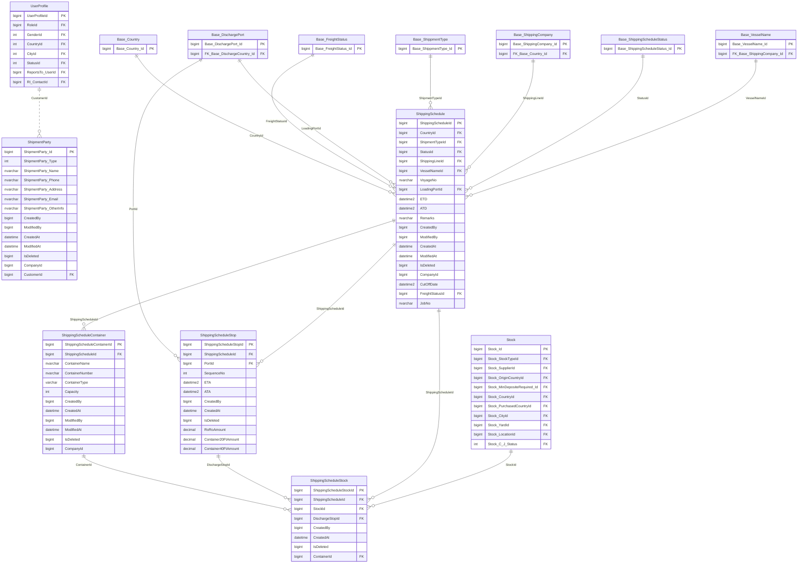

## Transport quoting

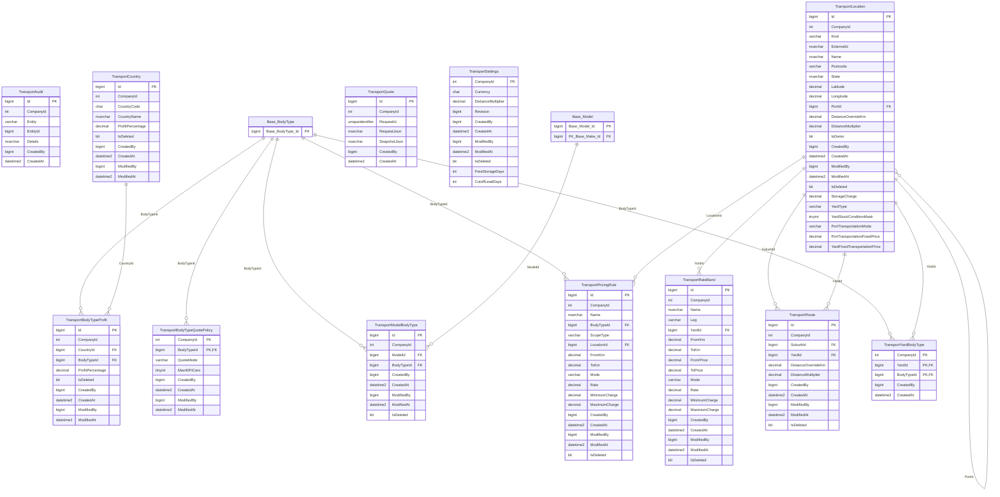

## Vendors

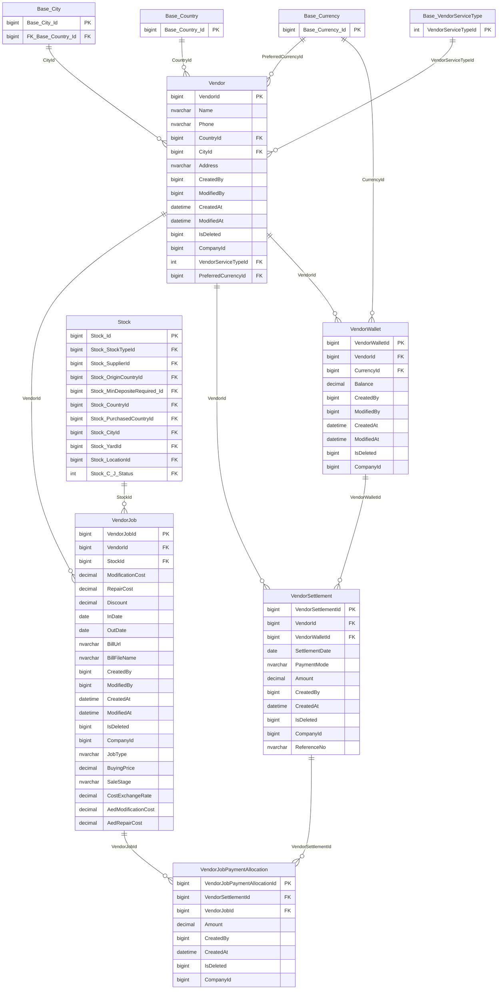

## Reports

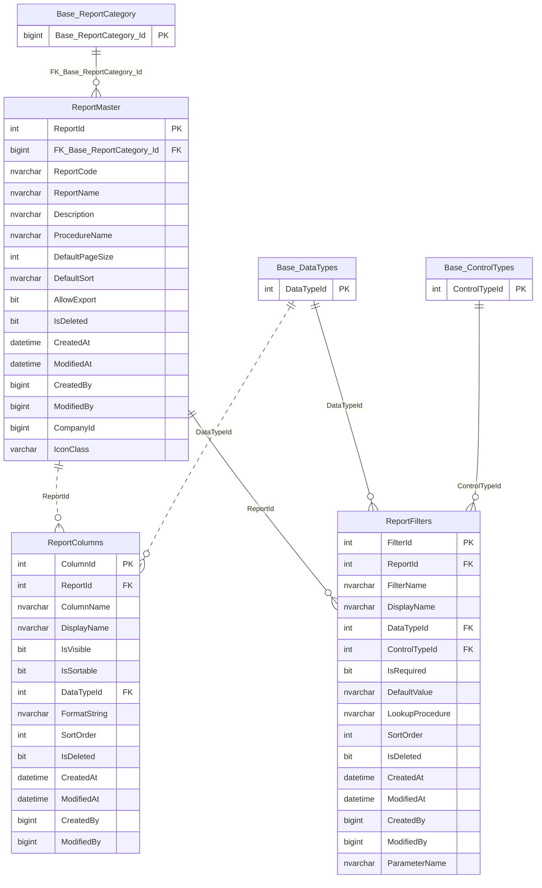

## respond.io integration

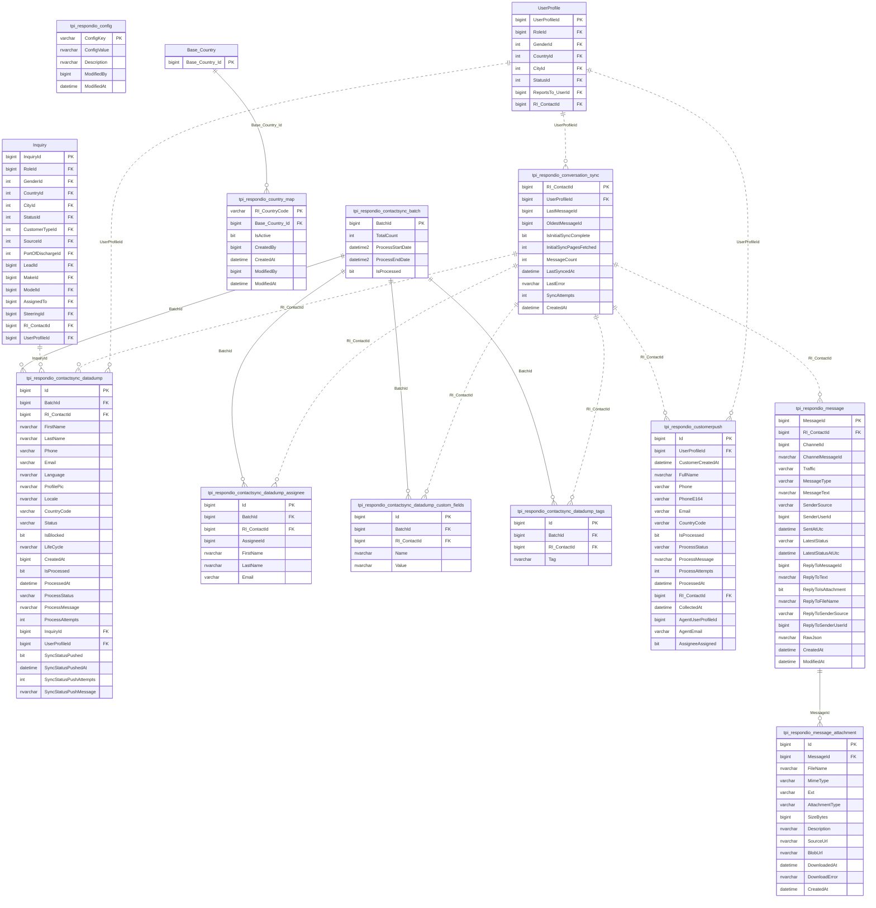

## Lookup tables

```mermaid
erDiagram
    Base_AdjustmentType {
        bigint Base_AdjustmentTypeId PK
    }
    Base_Approved {
        int ApprovedId PK
    }
    Base_Availability {
        bigint Base_Availability_Id PK
    }
    Base_Bank {
        bigint Base_Bank_Id PK
    }
    Base_BodyType {
        bigint Base_BodyType_Id PK
    }
    Base_City {
        bigint Base_City_Id PK
        bigint FK_Base_Country_Id FK
    }
    Base_Color {
        bigint Base_Color_Id PK
    }
    Base_CompanyIncomeType {
        int Id PK
    }
    Base_ContainerType {
        bigint Base_ContainerType_Id PK
    }
    Base_ControlTypes {
        int ControlTypeId PK
    }
    Base_Country {
        bigint Base_Country_Id PK
    }
    Base_CountryCodes {
        bigint Base_CountryCode_Id PK
        bigint FK_CountryId FK
    }
    Base_Currency {
        bigint Base_Currency_Id PK
    }
    Base_CustomerCountry {
        bigint Base_CustomerCountry_Id PK
    }
    Base_CustomerStatus {
        bigint CustomerStatusId PK
    }
    Base_CustomerType {
        bigint CustomerTypeId PK
    }
    Base_DataTypes {
        int DataTypeId PK
    }
    Base_DischargeCountry {
        bigint Base_DischargeCountry_Id PK
    }
    Base_DischargePort {
        bigint Base_DischargePort_Id PK
        bigint FK_Base_DischargeCountry_Id FK
    }
    Base_DriveType {
        bigint Base_DriveType_Id PK
    }
    Base_FinancialType {
        bigint Base_FinancialType_Id PK
    }
    Base_Folder {
        bigint Base_Folder_Id PK
    }
    Base_FreightStatus {
        bigint Base_FreightStatus_Id PK
    }
    Base_FreightType {
        bigint Base_FreightType_Id PK
    }
    Base_FuelType {
        bigint Base_FuelType_Id PK
    }
    Base_Gender {
        int GenderId PK
    }
    Base_Location {
        bigint Base_Location_Id PK
    }
    Base_Make {
        bigint Base_Make_Id PK
        bigint FK_Base_Country_ID FK
    }
    Base_Mileage {
        int Base_Mileage_Id
    }
    Base_MinDepositeRequired {
        bigint Base_MinDepositeRequired_Id PK
    }
    Base_Model {
        bigint Base_Model_Id PK
        bigint FK_Base_Make_Id FK
    }
    Base_ModeOfPayment {
        bigint Base_ModeOfPayment_Id PK
    }
    Base_ModificationType {
        bigint Base_ModificationType_Id PK
    }
    Base_NotificationType {
        int NotificationTypeId PK
    }
    Base_OriginCountry {
        bigint Base_OriginCountry_Id PK
    }
    Base_Port {
        bigint Base_Port_Id PK
        bigint FK_Base_City_Id FK
    }
    Base_PortDischarge {
        bigint Base_PortDischarge_Id PK
        bigint FK_Base_City_Id FK
    }
    Base_Price {
        int Base_Price_Id PK
    }
    Base_Reconcile {
        bigint Base_Reconcile_Id PK
    }
    Base_RemarkSource {
        bigint RemarkSourceId PK
    }
    Base_RepairType {
        bigint Base_RepairType_Id PK
    }
    Base_ReportCategory {
        bigint Base_ReportCategory_Id PK
    }
    Base_ReservationStatus {
        bigint Base_ReservationStatus_Id PK
    }
    Base_ShippingCompany {
        bigint Base_ShippingCompany_Id PK
        bigint FK_Base_Country_Id FK
    }
    Base_ShippingName {
        bigint Base_ShippingName_Id PK
    }
    Base_ShippingScheduleStatus {
        bigint Base_ShippingScheduleStatus_Id PK
    }
    Base_ShippmentType {
        bigint Base_ShippmentType_Id PK
    }
    Base_Source {
        bigint SourceId PK
    }
    Base_Steering {
        bigint Base_Steering_Id PK
    }
    Base_Stock_Feature {
        bigint Base_Stock_Feature_Id PK
    }
    Base_StockStatus {
        bigint Base_StockStatus_Id PK
    }
    Base_StockType {
        bigint Base_StockType_Id PK
    }
    Base_SubBodyType {
        bigint Base_SubBodyType_Id PK
        bigint FK_Base_BodyType_Id FK
    }
    base_sync_bodytype_mapping {
        bigint Id PK
    }
    base_sync_color_mapping {
        bigint Id PK
    }
    base_sync_FuelType_mapping {
        bigint Id PK
    }
    base_sync_make_mapping {
        bigint Id PK
    }
    base_sync_model_mapping {
        bigint Id PK
    }
    base_sync_Transmission_mapping {
        bigint Id PK
    }
    Base_TransactionMode {
        int TransactionModeId PK
    }
    Base_TransactionType {
        bigint Base_TransactionType_Id PK
    }
    Base_Transmission {
        bigint Base_Transmission_Id PK
    }
    Base_UserStatus {
        int UserStatusId PK
    }
    Base_VendorServiceType {
        int VendorServiceTypeId PK
    }
    Base_VesselName {
        bigint Base_VesselName_Id PK
        bigint FK_Base_ShippingCompany_Id FK
    }
    Base_WhitelistedIPs {
        bigint Base_WhitelistedIPs_Id PK
    }
    Base_Yard {
        bigint Base_Yard_Id PK
        bigint FK_Base_City_Id FK
    }
    BaseBodyType_Icons {
        int IconId PK
        int BaseBodyTypeId FK
    }
    Base_BodyType ||..o{ BaseBodyType_Icons : "BaseBodyTypeId"
    Base_Country ||..o{ Base_City : "FK_Base_Country_Id"
    Base_Country ||..o{ Base_CountryCodes : "FK_CountryId"
    Base_Country ||--o{ Base_DischargePort : "FK_Base_DischargeCountry_Id"
    Base_Country ||..o{ Base_Make : "FK_Base_Country_ID"
    Base_Make ||..o{ Base_Model : "FK_Base_Make_Id"
    Base_City ||..o{ Base_Port : "FK_Base_City_Id"
    Base_City ||..o{ Base_PortDischarge : "FK_Base_City_Id"
    Base_Country ||..o{ Base_ShippingCompany : "FK_Base_Country_Id"
    Base_BodyType ||--o{ Base_SubBodyType : "FK_Base_BodyType_Id"
    Base_ShippingCompany ||--o{ Base_VesselName : "FK_Base_ShippingCompany_Id"
    Base_City ||..o{ Base_Yard : "FK_Base_City_Id"
```

## Columns joined to more than one table

The procedures join these columns to different tables (polymorphic values or legacy inconsistency). The
diagram draws the most frequent partner only; the counts are JOIN occurrences across procedures and views.

| Column | Joined to |
|---|---|
| `Notification.EntityId` | `CustomerRefundRequest` (1), `Customer_WalletDetail` (1), `BankStatementDetailApproval` (1) |
| `Stock.Stock_CityId` | `Base_City` (13), `Base_Country` (1) |
| `Stock.Stock_CountryId` | `Base_Country` (16), `Base_OriginCountry` (1) |
| `Stock.Stock_PurchasedCountryId` | `Base_Country` (1), `Base_OriginCountry` (1) |
| `Stock.Stock_SupplierId` | `UserProfile` (11), `Supplier` (2) |
| `Stock_Reservation_Detail.Stock_R_D_Destination_CountryId` | `Base_OriginCountry` (2), `Base_Country` (1) |
| `Stock_StatusDetail.Stock_SD_StockStatus_Value` | `Base_Availability` (2), `Base_ReservationStatus` (2) |

## Tables with no detected relationship

`ActionURlTbl`, `AuthorizationKeys`, `Base_CustomerCountry`, `Base_DischargeCountry`, `Base_Folder`, `Base_Mileage`, `Base_ModeOfPayment`, `Base_Price`, `Base_Reconcile`, `Base_ShippingName`, `base_sync_bodytype_mapping`, `base_sync_color_mapping`, `base_sync_FuelType_mapping`, `base_sync_make_mapping`, `base_sync_model_mapping`, `base_sync_Transmission_mapping`, `Base_WhitelistedIPs`, `DataAccessScope`, `DiscoutRequestStatus`, `EmailOutbox`, `garagevisitype`, `SortOptions`, `StockType`, `Supplier`, `SYS_AuthTable`, `SYS_DropDownsWithAuth`, `SYS_DropDownsWithOutAuth`, `SYS_PublicMethod`, `tpi_respondio_config`, `TransportAudit`, `TransportQuote`, `TransportSettings`, `UserAuthState`, `WEB_ApiKeys`, `web_stock_tabs`
